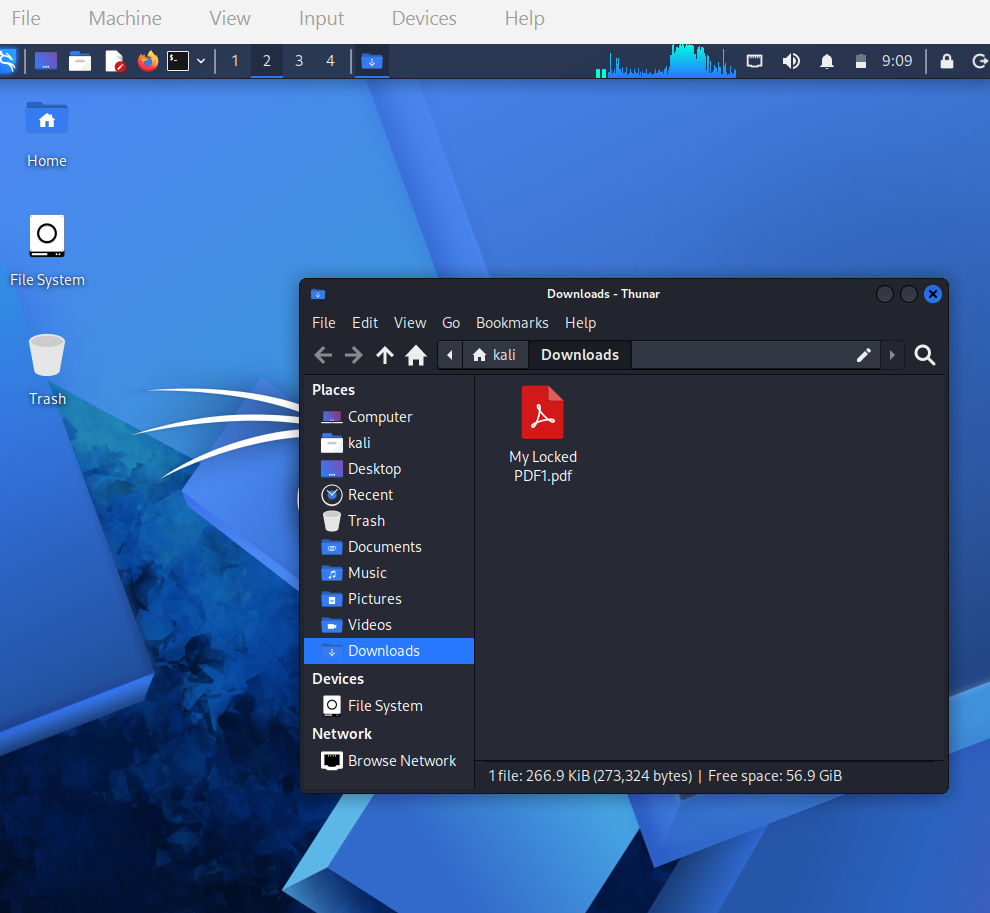
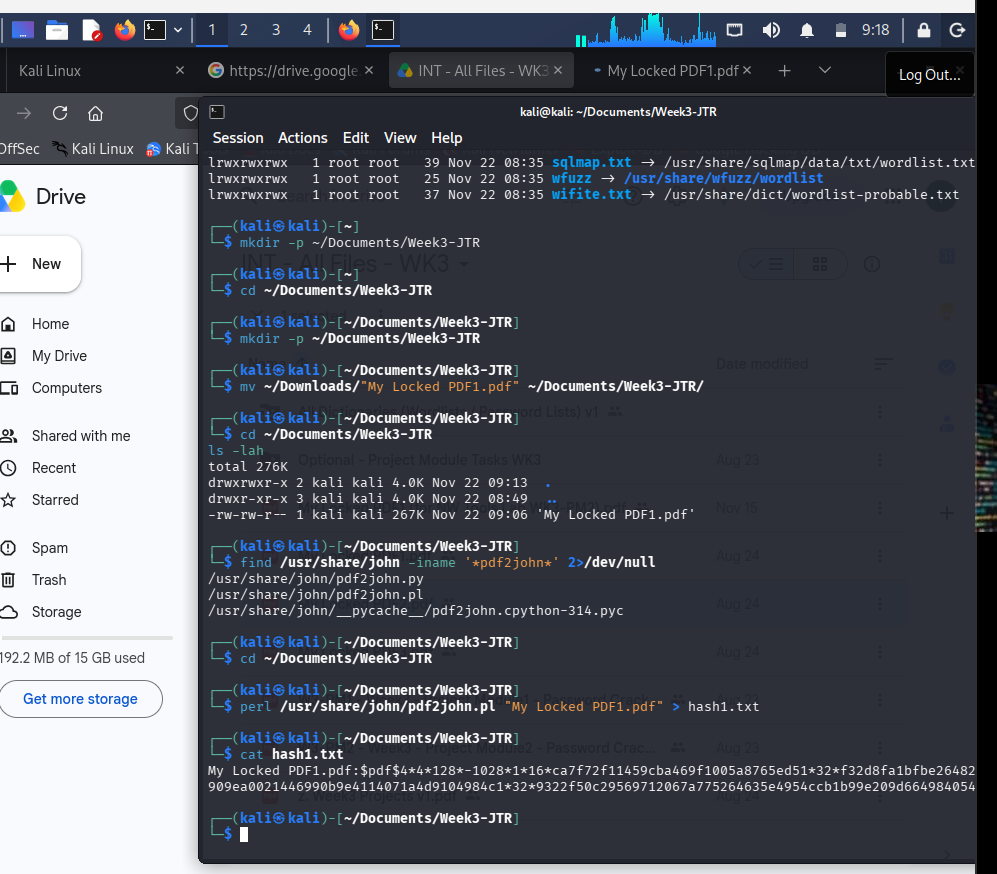
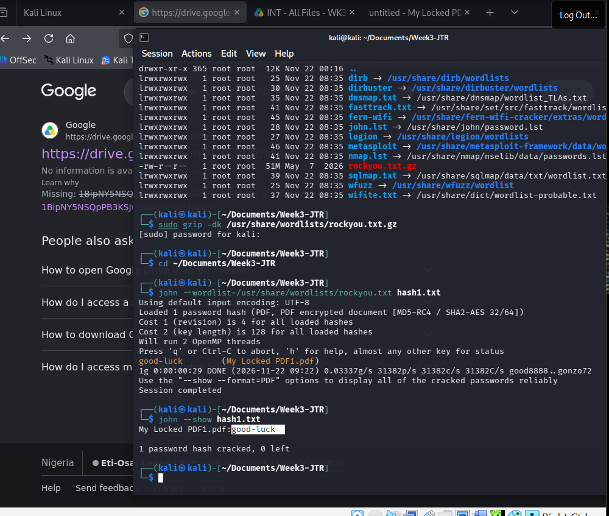
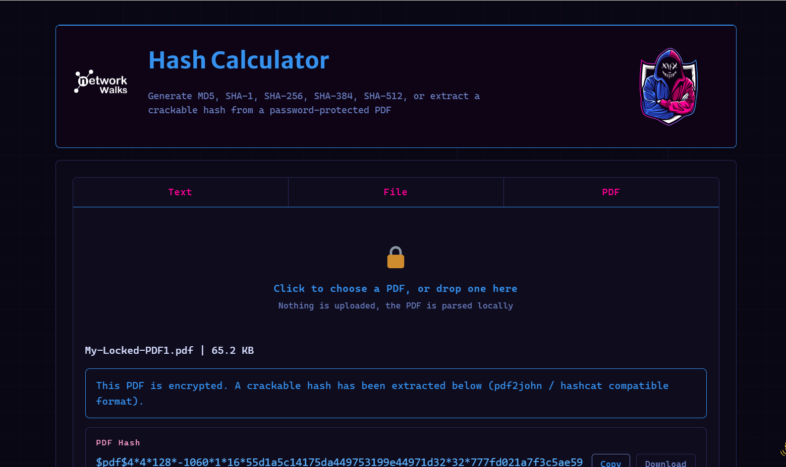
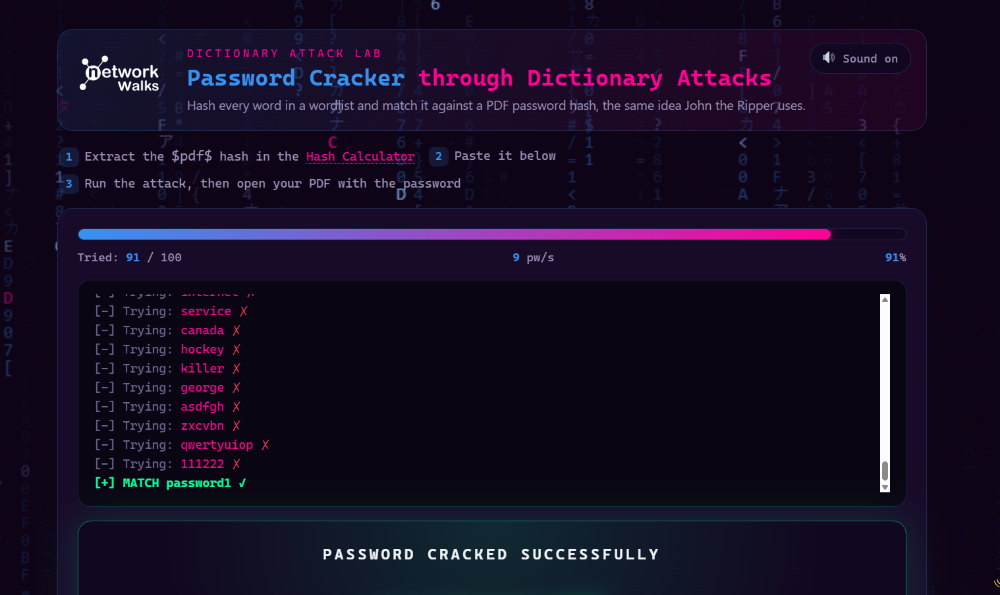

<div align="center">

# Week 3 · Password Cracking with John the Ripper

### NetworkWalks Academy

**Cybersecurity Internship · Batch B084**

`KALI LINUX`　`VIRTUALBOX LAB`　`JOHN THE RIPPER`　`AUTHORIZED TRAINING`

</div>

---

## Project information

| Field | Details |
|---|---|
| **Author** | Okon Inemesit Udo |
| **Programme** | NetworkWalks Cybersecurity Internship |
| **Batch** | B084 |
| **Week** | 03 |
| **Module** | W3-PM1 — Password Cracking with John the Ripper & NetworkWalks Hash Calculator |
| **Environment** | Kali Linux running in Oracle VirtualBox |

## Overview

This repository contains the practical documentation and evidence for the Week 3 password-cracking exercise. The documented workflow covers extracting a password hash from a protected PDF, testing candidate passwords with John the Ripper, and verifying the result.

Screenshots from the NetworkWalks Hash Calculator and Dictionary Attack training interfaces are included as supporting evidence.

## Objectives

- Prepare the password-protected PDF in the Kali Linux environment.
- Extract the PDF hash using `pdf2john`.
- Test the extracted hash against a wordlist with John the Ripper.
- Verify the recovered password using JTR's `--show` option.
- Record the results displayed by the NetworkWalks training tools.

## Tools and environment

| Tool | Purpose |
|---|---|
| Kali Linux | Operating system for the practical exercise |
| Oracle VirtualBox | Virtual lab environment |
| John the Ripper | Dictionary-based password recovery |
| `pdf2john` | PDF password-hash extraction |
| `rockyou.txt` | Wordlist used for password testing |
| NetworkWalks Hash Calculator | Training interface for PDF hash extraction |
| NetworkWalks Dictionary Attack Lab | Training interface for dictionary-based testing |

## Practical procedure and evidence

### 1. Locate the protected PDF

The password-protected PDF was located in the Kali Linux Downloads directory before being moved into the Week 3 working folder.



*Figure 1. Protected PDF file in the Kali Linux Downloads directory.*

### 2. Extract the PDF hash and run John the Ripper

The PDF hash was extracted and saved to a text file. John the Ripper was then run against the hash using the RockYou wordlist.



*Figure 2. Terminal evidence of the hash preparation and JTR workflow.*

### 3. Verify the recovered password

John the Ripper reported one password hash cracked. The `--show` output displayed the recovered password for the local practice PDF.



*Figure 3. JTR verification output. The recovered password shown for the local practice PDF is `good-luck`.*

### 4. Extract a hash with the NetworkWalks Hash Calculator

The supplied NetworkWalks training screenshot shows the protected PDF being processed and a crackable hash being displayed.



*Figure 4. NetworkWalks Hash Calculator output.*

### 5. Review the dictionary-attack result

The NetworkWalks Dictionary Attack interface shows candidate passwords being tested and a successful match being reported.



*Figure 5. Training interface showing a successful candidate match for `password1`.*

### 6. Record the flag displayed in the training PDF

The supplied screenshot of the opened PDF displays the following flag:

`nw{networkwalks_flag1_jtr_270521_1}`


*Figure 6. Flag displayed in the opened training PDF.*

### 7. Record the challenge confirmation

The NetworkWalks completion graphic displays the following captured flag:

`nw{cybersecurity_flag_captured_2608}`


*Figure 7. NetworkWalks challenge confirmation.*

## Results

| Evidence source | Result shown |
|---|---|
| Local Kali Linux / John the Ripper | One hash cracked; password displayed as `good-luck` |
| NetworkWalks Dictionary Attack interface | Successful candidate match: `password1` |
| Opened training PDF | `nw{networkwalks_flag1_jtr_270521_1}` |
| Challenge confirmation graphic | `nw{cybersecurity_flag_captured_2608}` |

The results are recorded separately because they appear in different screenshots and represent different stages or training outputs.

## Module coverage

| Week 3 requirement | Documentation status |
|---|---|
| **W3-PM1 — Password Cracking with JTR** | Evidence included in this repository |
| **W3-PM2 — Password Cracking with NetworkWalks Tools** | Separate PM2 evidence/report still to be added |

This README documents the PM1/JTR work and the related NetworkWalks interface screenshots supplied for this report. It does not claim that the full PM2 module has been completed.

## Repository contents

```text
NETWORKWALKS-WEEK3-PASSWORD-CRACKING-B084/
│
├── README.md
├── Week3_PM1_JTR_Practical_Report.pdf
│
├── evidence/
│   ├── 01_pdf_file_in_kali_downloads.png
│   ├── 02_jtr_hash_extraction_and_terminal.png
│   ├── 03_jtr_recovered_pdf_password.png
│   ├── 04_hash_calculator_pdf_hash_extraction.png
│   ├── 05_dictionary_attack_progress_and_match.png
│   ├── 06_cracked_pdf_flag_display.png
│   └── 07_week3_flag_capture_confirmation.png
│
└── design-reference/
    └── week2_github_header_style_reference.png
```

## Responsible use

The techniques documented here are intended for authorized cybersecurity training. Password recovery should only be performed on files, accounts, and systems that you own or have explicit permission to test.

---

<div align="center">

**Okon Inemesit Udo**  
NetworkWalks Cybersecurity Internship · Batch B084

</div>
